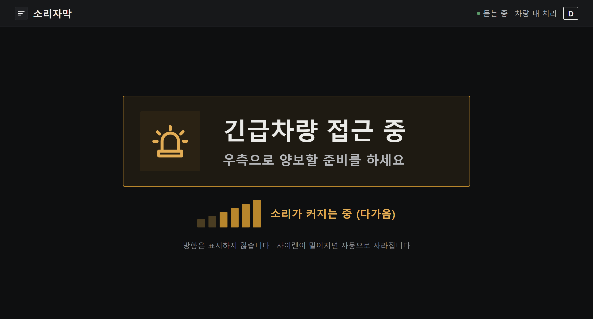
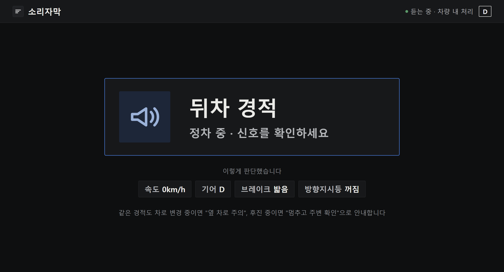
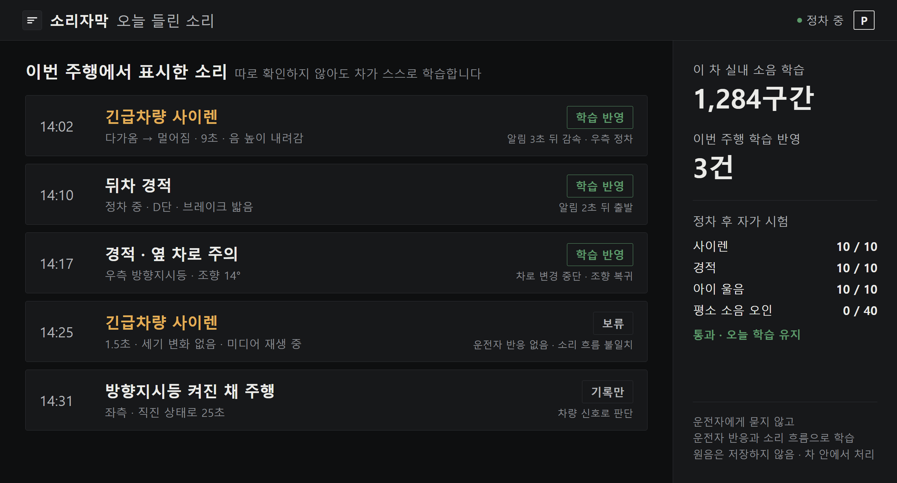
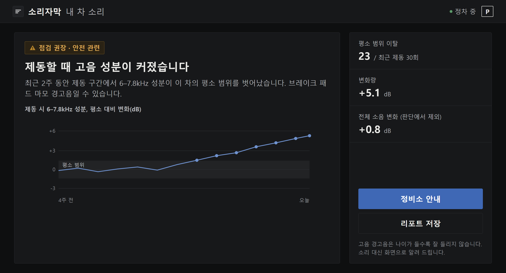

# 소리자막 (Sound Captions)

청각장애·난청 운전자가 듣지 못하는 **긴급차량 사이렌, 경적, 뒷좌석 아이 울음, 내 차의 경고음**을 차량 상황에 맞춰 해석해 운전석 화면에 한 줄로 보여 주는 Pleos Connect 차량용 앱입니다. 차마다 다른 실내 소음에 차 안에서 스스로 적응하고, 운전자에게 묻지 않고 운전자 반응과 소리 흐름으로 스스로 정답을 만들어 학습합니다.

현대자동차그룹 Pleos 차량용 앱 개발 공모전 출품작입니다.

| 주행 중 사이렌 | 경적을 차량 상황으로 해석 |
|---|---|
|  |  |
| **정차 중 기록과 자동 학습·자가 시험** | **내 차 소리 변화** |
|  |  |

## 주요 기능
- **긴급차량 사이렌**: 다가옴/멀어짐을 세기 변화로 표시 (마이크 하나라 방향은 표시하지 않음)
- **경적의 의미 해석**: 경적이 울린 순간의 속도·기어·브레이크·방향지시등·핸들로 "뒤차 경적 · 신호 확인", "옆 차로 주의", "멈추고 주변 확인"을 구분
- **뒷좌석 아이 울음**: 뒷좌석 착석 센서가 사람이 있다고 할 때만 동작
- **방향지시등 켜진 채 주행**: 소리 없이 차량 신호만으로 판단
- **내 차 소리 변화**: 제동 시 고음 성분(브레이크 마모 경고음 등)이 평소 범위를 벗어나면 정차 후 점검 권장
- **운전자에게 묻지 않는 자동 학습**: 감속·정차·우측 조향(사이렌), 출발·차로 변경 중단(경적) 같은 반응과 소리의 지속·세기 변화가 모두 맞을 때만 학습
- **자가 시험과 되돌림**: 정차할 때마다 정답이 정해진 시험 소리를 이 차의 배경과 섞어 시험하고, 성능이 떨어지면 그날 배운 것을 버리고 직전 모델로 되돌림. 하루 학습량 상한, 출고 모델 보관
- 주행 중에는 조작 없이 보기만 하는 알림 한 줄, 정비·기록·설정은 정차 중에만

## 제출 APK
- 위치: [`apk/정지윤_소리자막_release.apk`](apk/) (서명된 release 빌드, v0.1.0)

## 테스트 환경
- Pleos Connect Emulator v2.1.0 (Android 14, API 34, Android Automotive)
- 화면 규격: 2560 × 1440, 밀도 160
- Pleos Vehicle SDK 2.3.2, Android Gradle Plugin 9, Kotlin, compileSdk 34, minSdk 28

## 실행 방법
1. 에뮬레이터를 켜고 APK를 설치합니다: `adb install -r -g apk/<APK 파일 이름>`
   - `-g`는 아래 권한을 설치할 때 한 번에 허용합니다. 빼고 설치했다면 처음 실행할 때 마이크 권한을 허용해 주세요.
2. 앱 목록에서 "소리자막"을 실행합니다.
3. **시연 모드**: 화면 제목 "소리자막"을 길게 누르거나 `adb shell am start -n com.soundwitness.app/.MainActivity --ez demo true`
   - 80초 주행 시나리오(다가왔다 멀어지는 사이렌, 신호 대기 중 뒤차 경적, 차로 변경 중 경적, 뒷좌석 아이 울음, 음악 속 사이렌, 방향지시등 켜진 채 주행)가 합성 소리와 차량 상태로 재생되며, 마이크 소리와 같은 처리 경로를 탑니다. 끝나면 정차 화면에서 오늘 들린 소리와 자동 학습 판단, 자가 시험 결과를 볼 수 있습니다.
4. 시연 모드 밖에서는 실내 마이크와 Virtual Console의 차량 신호(기어·속도·브레이크·방향지시등·핸들·좌석)로 동작합니다.

필요한 권한(모두 설치 시 동의): `RECORD_AUDIO`(마이크), Pleos 차량 권한 `CAR_DRIVE`, `CAR_CLIMATE`, `CAR_WINDOWS`, `CAR_SAFETY`, `READ_CAR_STEERING`, `CAR_LIGHTS`, `CAR_SEATS`(모두 읽기 전용)

## 직접 빌드
- debug: `./gradlew :app:assembleDebug` → `app/build/outputs/apk/debug/app-debug.apk`
- release: 서명 정보 파일이 있을 때 `./gradlew :app:assembleRelease -Psigning.props=<keystore.properties 경로>` (서명 키는 저장소에 포함하지 않음)

## 테스트
`./gradlew :app:testDebugUnitTest`
- `EventDetectorTest`: 합성 사건음 인식·오인, 경적 해석, 반응 기반 자동 학습, 잘못 배운 내용의 자가 시험 되돌림
- `DemoPipelineTest`: 80초 시연 시나리오 전체를 앱과 같은 경로로 처리해 의도한 알림과 학습 판단이 나오는지 확인
- `RealDataLadderTest`: 실제 녹음(ESC-50) 단계별 평가. 데이터가 없으면 건너뜀(`ESC50_16K` 환경변수 또는 `../data/esc50_16k`)

## 소리 인식 구조와 실제 데이터 예비 평가
현재 APK(v0.1.0)의 소리 종류 판단은 합성 소리로 만든 카운팅 모델(곱셈 없이 시간-주파수 패턴의 개수를 세는 방식, 학습은 개수 더하기)이며 동작 확인용입니다. 실제 녹음으로 평가한 결과에 따라 다음 버전은 **두 층 구조**로 바꿉니다.

1. 아래층: 공개 범용 소리 모델 YAMNet(AudioSet 약 208만 개 클립으로 학습, 분류용 TFLite 약 4MB, Apache 2.0)이 사이렌·경적·아기 울음일 가능성을 냄
2. 위층(차량별 보정, 모두 역전파 없이 합·개수 누적으로 차 안에서 학습)
   - 이 차 평소 배경 대비 대역 에너지 초과량
   - 이 차 평소 소리로 정하는 문턱
   - 이 차 배경이 범용 모델에서 어떤 라벨로 읽히는지 세는 카운팅 보정
   - 소리 종류별 임베딩 평균을 쌓는 클래스 통계 분류기
   - 사이렌 주파수 궤적 검사

ESC-50 실제 녹음, 가상 차량 4대(엔진·비·바람·기차 + 차체 감쇠), 학습하지 않은 차로만 평가, 사건음 크기 실내 소음 대비 +6~−6dB:

| 단계 | 배경 대비 AUC |
|---|---|
| 범용 모델(YAMNet)만 | 0.80 |
| + 배경 기준선 대비 초과량 | 0.85 |
| + 기준선·문턱을 이 차의 평소 소리로 자동 적응 | 0.88 |
| + 카운팅 보정 | 0.89 |
| + 클래스 통계 분류기 + 반응 학습 + 사이렌 궤적 | 0.94 |

사이렌과 다른 큰 소리를 가르는 AUC는 클래스 통계 분류기와 사이렌 궤적 검사로 0.76 → 0.83. **남은 과제**: 개 짖음·알람시계 같은 다른 큰 소리와 사건음 전체를 가르는 AUC는 0.70 안팎에 머물러, 이런 소리를 사건음으로 잘못 잡는 문제가 남아 있음. 자세한 결과와 실패한 시도는 [docs/real_data_eval.md](docs/real_data_eval.md), 문헌 조사와 개선 계획은 [docs/improvement_research.md](docs/improvement_research.md).

### 재현 (research/)
Python 3, numpy, scipy, h5py. 데이터와 모델은 저장소에 포함하지 않습니다.
1. ESC-50(https://github.com/karolpiczak/ESC-50, CC BY-NC) 압축 파일을 받아 `python research/prep_esc50.py ESC-50-master.zip data/esc50_16k`
2. YAMNet 가중치 `yamnet.h5`와 `yamnet_class_map.csv`(https://github.com/tensorflow/models/tree/master/research/audioset/yamnet)를 `data/yamnet/`에
3. 특징 추출: `python research/ybuild.py <0..3> research/ysplits`, `python research/ybuild_fm.py <0..3> research/ysplits`
4. 평가: `python research/yfuse.py research/ysplits`, `python research/ytest13.py research/ysplits`

`yamnet_np.py`는 공식 YAMNet(features.py, yamnet.py)을 numpy로 옮긴 추론 코드입니다.

## 폴더
- `app/src/main/java/com/soundwitness/app/`
  - `audio/` 순환 녹음, 대역 스펙트로그램, 말소리 제외
  - `learn/` 카운팅 모델, 배경 기준선, 내 차 소리 변화
  - `events/` 사건음 인식, 차량 상황 해석, 자동 학습, 자가 시험
  - `vehicle/` Pleos Vehicle SDK 연동
  - `demo/` 시연 시나리오
  - `ui/` 주행·정차 화면
- `app/src/test/` 단위 테스트와 실제 데이터 평가
- `research/` 실제 데이터 실험 스크립트
- `docs/` 화면 시안, 실험 기록, 문헌 조사

## 데이터·라이선스 고지
- ESC-50: CC BY-NC 3.0. 연구·평가에만 사용하며 저장소에 포함하지 않음
- YAMNet: Apache 2.0. 저장소에 포함하지 않음
- 소리와 차량 데이터는 차 안에서만 처리하고 원음은 저장하지 않습니다.
